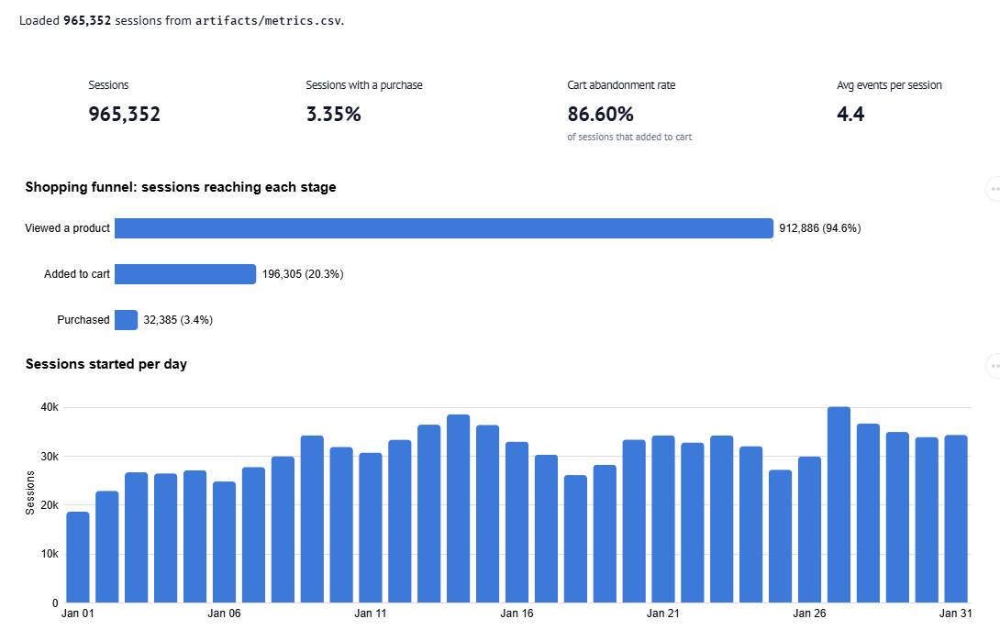

# Signal Design for Clickstream Analysis

Continuous Intelligence | Project 03 | Clickstream Analysis

## Overview

A Polars pipeline that turns raw online-shopping clickstream
events into session-level behavioral signals: session duration,
activity counts, funnel ratios (view → cart → purchase),
and a cart-abandonment flag.

A reactive marimo app presents the signals as funnel KPIs and charts.

## Data

The pipeline reads clickstream events from `data/2020-Jan.csv`
(about 4.26 million events from an online cosmetics store, January 2020).
A 20-row sample is provided in `data/example-data.csv`.

Each row in the raw dataset is one user interaction with these fields:

* `event_time`    – Timestamp of the interaction (UTC).
* `event_type`    – User action: `view`, `cart`, `remove_from_cart`, `purchase`.
* `product_id`    – Product identifier.
* `category_id`   – Product category identifier.
* `category_code` – Product category name (often empty).
* `brand`         – Product brand (often empty).
* `price`         – Product price at the time of the event.
* `user_id`       – Unique user identifier.
* `user_session`  – Unique ID for a single browser session.

[View Example Dataset](https://github.com/itsanibose/cintel-03-signal-design-clickstream/blob/main/data/example-data.csv)

## Methods

Events are grouped by `user_session`, and each session becomes one row
with these signals (see `design_clickstream_metrics()` in `utils_system.py`):

* `session_start_time` / `session_end_time` – First and last event time.
* `session_duration`        – Time between first and last event (ISO 8601).
* `total_events`            – Number of events in the session.
* `views`, `carts`, `remove_from_carts`, `purchases` – Count of each event type.
* `cart_to_view_ratio`      – `carts / views` (0 when there are no views).
* `purchase_to_cart_ratio`  – `purchases / carts` (0 when there are no carts).
* `session_conversion_rate` – `purchases / views` (0 when there are no views).
* `abandoned_cart`          – True when the session added to cart but never purchased.

The pipeline writes the session signals to `artifacts/metrics.csv`.

## Results

The full January data produced 965,352 sessions:

| Signal | Observed Value |
|---|---|
| Sessions with at least one view | 94.6% |
| Sessions with at least one add-to-cart | 20.3% |
| Sessions with a purchase | 3.4% |
| Cart abandonment (of sessions that added to cart) | 86.6% |
| Events per session | 1 to 2,458 (median 1, mean 4.4) |
| Single-event sessions | 64.9% |

# Visualization in marimo interactive app

[View Signal Results](https://github.com/itsanibose/cintel-03-signal-design-clickstream/blob/main/artifacts/example-metrics.csv)

## Interpretation

Most sessions are short and end after viewing a single product,
so raw event counts mostly measure browsing, not buying.

The funnel signals show where shoppers drop off: about one in five
sessions adds to cart, but most of those carts are abandoned,
and only about 3% of sessions end in a purchase.

The `abandoned_cart` flag points directly at sessions worth
follow-up (for example, reminder emails or checkout fixes).

## Limitations

Sessions are defined only by `user_session`; a single shopper
can appear in many sessions, so these are not per-user signals.

Ratios can exceed 1 (for example, many carts after one view,
or purchases with no recorded cart event), because events are
counted rather than matched product by product.

Duration is measured from first to last event, so single-event
sessions have zero duration, and the analysis covers only one month.

## Conclusion

Grouping raw events into sessions turns millions of rows into
signals that answer business questions directly:
how far shoppers get in the funnel, and where they leave.

## Documentation Index

- **Home** - this landing page
- [**Project Instructions**](project-instructions.md)
- [**Glossary**](glossary.md)
- [**API**](api.md)
- [**Reactive App**](./app/index.html)

## Project Links

- [GitHub Repository](https://github.com/itsanibose/cintel-03-signal-design-clickstream)
- [Example Pipeline](https://github.com/itsanibose/cintel-03-signal-design-clickstream/blob/main/src/cintel/signal_design.py)
- [Signal Utilities](https://github.com/itsanibose/cintel-03-signal-design-clickstream/blob/main/src/cintel/utils_system.py)
- [Reactive App Source](https://github.com/itsanibose/cintel-03-signal-design-clickstream/blob/main/src/cintel/app.py)
- [Results and Artifacts](https://github.com/itsanibose/cintel-03-signal-design-clickstream/tree/main/artifacts)

## Project Resources

- [Project Instructions](project-instructions.md)
- [Professional Python Guide](https://denisecase.github.io/pro-analytics-02/)
- [Professional Python Project Explainer](https://pup-pack.github.io/professional-python-project-explainer/).
- [Suggested Datasets](https://denisecase.github.io/pro-analytics-02/reference/datasets/cintel/)
